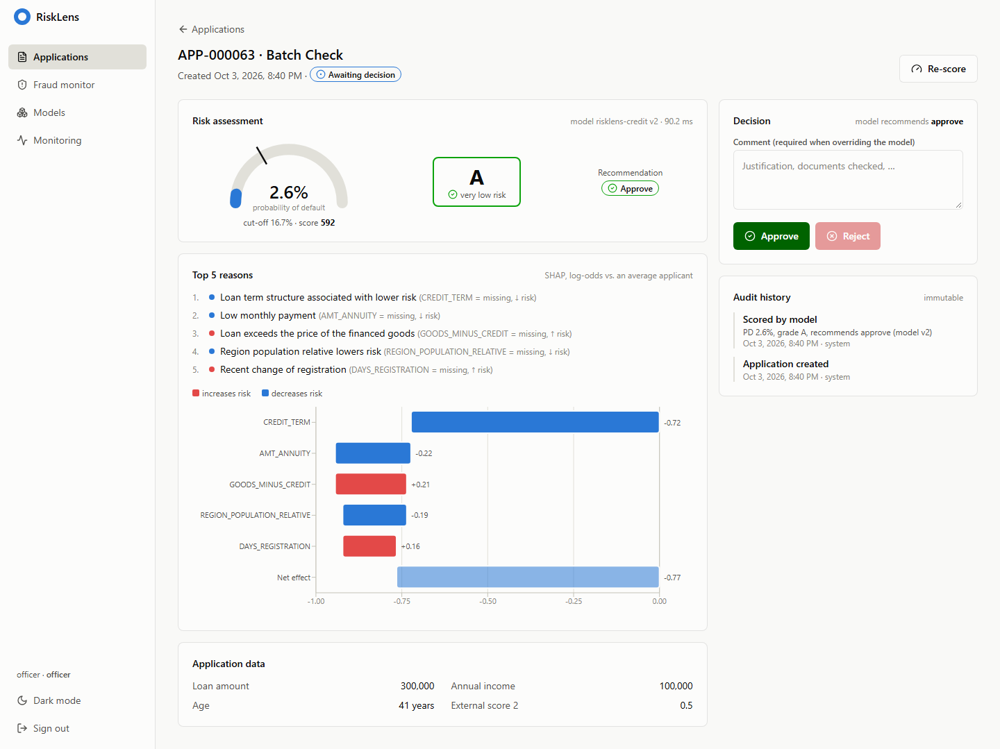
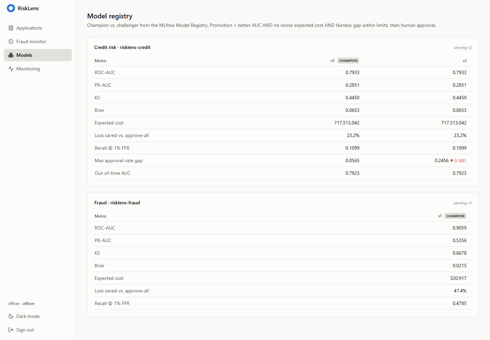
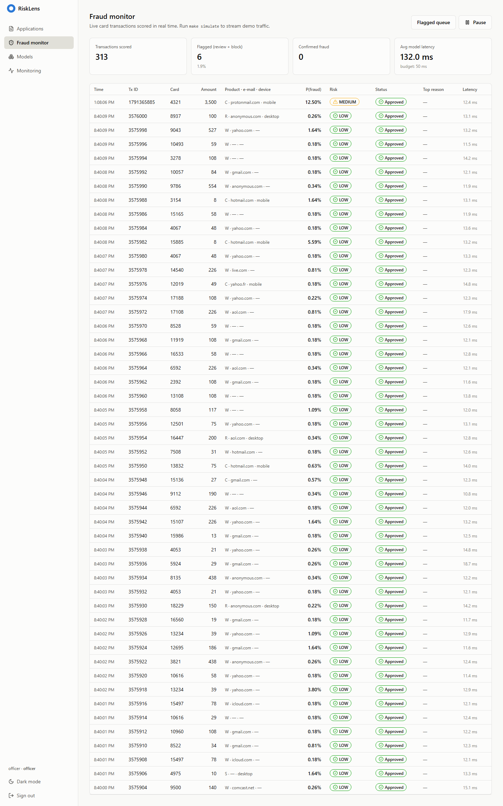
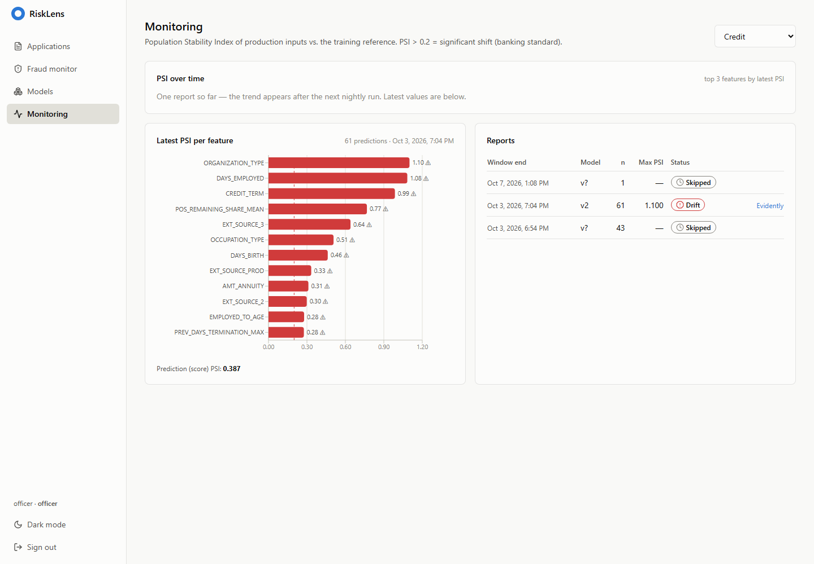
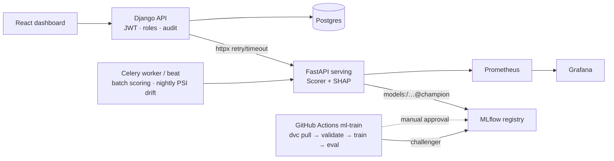

# RiskLens

**Real-time credit-risk & fraud scoring that explains every decision with SHAP and retrains itself safely through an MLflow champion/challenger gate.**

[](.github/workflows/ci.yml)
[](.github/workflows/ml-train.yml)


<sub>40-second walkthrough recorded from the running app ([MP4, 2 MB](docs/media/demo.mp4)) · re-record with `make demo`</sub>

| Application decision (PD gauge, grade, SHAP waterfall, audit) | Model registry (champion vs challenger) |
|---|---|
|  |  |
| **Fraud monitor** (live feed, flagged rows) | **Monitoring** (PSI per feature, Evidently reports) |
|  |  |

Dark-mode versions are in [docs/screenshots](docs/screenshots/).

---

## 1. The problem

| Module | Question | Why it matters |
|---|---|---|
| **A · Credit risk** | Will this applicant default (PD)? | Approving a defaulter loses `loan × LGD`; rejecting a good customer loses the margin. Regulators require reasons for every adverse decision. |
| **B · Fraud** | Is this card transaction fraud? | Must answer in **< 50 ms**, before authorisation. |

Business metrics reported (not just AUC): **expected loss saved vs. the approve-everyone policy**, approval rate at a fixed risk level, **fraud recall at 1% false-positive rate**.

## 2. Architecture


Details, the Scorer bundle and the model lifecycle: [docs/architecture.md](docs/architecture.md) · decisions: [docs/adr/](docs/adr/).

## 3. Results (real numbers, frozen test sets)

### Credit risk – Home Credit Default Risk (307,511 applications; test = 46,127, stratified, DVC-frozen)

| Model | ROC-AUC | PR-AUC | KS | Brier | Expected cost* |
|---|---|---|---|---|---|
| Logistic regression (WOE scorecard) | 0.7625 | 0.2350 | 0.3973 | 0.0677 | 771.8 M |
| LightGBM | 0.7923 | 0.2781 | 0.4425 | 0.0654 | 718.7 M |
| XGBoost | 0.7907 | 0.2802 | 0.4408 | 0.0654 | 725.3 M |
| CatBoost | 0.7907 | 0.2795 | 0.4375 | 0.0655 | 723.3 M |
| **Stacking (final, isotonic-calibrated)** | **0.7933** | **0.2851** | **0.4450** | **0.0653** | **717.5 M** |

\* cost on the test set at the cost-optimal threshold chosen on validation (FN = loan × 45% LGD, FP = loan × 8% margin; `ml/configs/costs.yaml`).

* **Loss saved vs. approve-all: 216 M (−23.2%)** at an approval rate of **86.2%**; bad rate of the approved book 4.9% (vs. 8.1% overall).
* Out-of-time style check (train on lowest 85% `SK_ID_CURR`, test on newest 15%): **AUC 0.7923** – no degradation.
* Fairness (decisions): approval-rate gap by gender **0.056** (gender is *not* a model input) → passes the 0.10 gate; age gap 0.246 is reported (see [docs/fairness.md](docs/fairness.md)).
* Reference: strong Kaggle solutions reach ~0.80 with hundreds of hand-made features; a good single LightGBM gets ~0.78–0.79.

### Fraud – IEEE-CIS (590,540 transactions; **time-based** split, test = last 20% of time)

| Model | ROC-AUC | PR-AUC | KS | Recall @ 1% FPR |
|---|---|---|---|---|
| LightGBM + client-id (`card1+addr1+D1n`) velocity features | **0.9059** | **0.5356** | 0.6678 | **47.8%** |

### Serving (one uvicorn worker, real Kaggle rows)

| Endpoint | p50 | p95 |
|---|---|---|
| Fraud authorisation path (`/v1/fraud/score`) | **13 ms** | **18 ms** (budget 50 ms) |
| Credit score + top-5 SHAP reasons (`/v1/credit/score`) | 79 ms | 95 ms |

Fraud explanations run only for flagged transactions: exact TreeSHAP on the 1k-tree fraud model costs ~215 ms, and the smaller models that would make it cheap lose 4 points of recall ([ADR 0004](docs/adr/0004-fraud-explanations-only-for-flagged.md)). Full tables, grade calibration and the tree-size experiment: [docs/results.md](docs/results.md).

## 4. Tech stack

| Layer | Tech |
|---|---|
| ML | pandas · LightGBM · XGBoost · CatBoost · scikit-learn (WOE logistic, isotonic) · Optuna (TPE + median pruner) · SHAP (TreeSHAP) · Fairlearn · pandera · Evidently |
| MLOps | MLflow tracking + registry (aliases), DVC + MinIO, GitHub Actions train / eval / promote |
| Serving | FastAPI · pydantic · Prometheus client · structlog · Redis history store |
| Backend | Django 5 · DRF · SimpleJWT (rotation + blacklist) · drf-spectacular · django-filter · Celery + beat |
| Frontend | React 18 · TypeScript · Vite · Tailwind · TanStack Query · React Router · Recharts · Zod |
| Infra | Docker (multi-stage, non-root) · Compose · nginx · Postgres 16 + pgvector · Prometheus · Grafana · Helm chart |
| Quality | pytest · hypothesis · factory_boy · Vitest + RTL · Playwright · ruff · mypy (strict on `ml/`) · pre-commit · gitleaks · trivy · pip-audit |

## 5. Quick start

```bash
cp .env.example .env            # change the CHANGE-ME values
make setup                      # uv + npm + pre-commit
make up                         # full stack: http://localhost:3000  (API docs :8000/api/docs, MLflow :5000, Grafana :3001)
make seed                       # demo users admin / officer / viewer + scored applications
make simulate                   # stream card transactions into the fraud monitor
```

Train on the real data (Kaggle account needed, or drop the CSVs into `data/raw/…`):
```bash
make data          # kaggle download + dvc add
make features      # ~1 min
make train         # credit: 5 models + 5-fold stacking (~17 min, 12 cores) → MLflow, registered version
make train-fraud   # ~4 min
make bootstrap-models   # first champion; afterwards: make promote → make approve
```
No Kaggle access? `risklens train -c ml/configs/ci.yaml` trains the whole pipeline on synthetic data in < 1 min.

**Without Docker (Windows):** after training and `make bootstrap-models`, run
`powershell -ExecutionPolicy Bypass -File scripts\run_local.ps1 -Seed` to start MLflow, serving, Django (SQLite) and Vite natively (app on http://localhost:5173), then
`python scripts/smoke_e2e.py --api http://localhost:8000` to verify the whole flow end to end.

## 6. Project structure

```
ml/            risklens package: data · features · models · evaluation · explain · fairness · monitoring · pipelines · cli
  configs/     credit.yaml · fraud.yaml · costs.yaml · ci*.yaml       (all thresholds, params, costs)
  notebooks/   01_eda · 02_target_analysis · 03_fraud_eda
serving/       FastAPI model server (routes, model_loader, feature_service, metrics)
backend/       Django: users · applicants · scoring · transactions · monitoring · audit · mlmodels
frontend/      React: applications · decision · fraud · models · monitoring
infra/         docker-compose · nginx · prometheus (+ alerts) · grafana dashboards · helm chart · mlflow image
.github/       ci · cd · ml-train · ml-eval
docs/          architecture · ADRs · api · eda · fairness · results
```

## 7. Swapping components (design for change)

| Change | What you touch |
|---|---|
| New model (e.g. TabNet) | add a `Classifier` subclass with `@register_model("tabnet")`, list it in `configs/credit.yaml` – pipelines, stacking, MLflow logging and serving need no change |
| New data source | add `features/<source>.py` + one line in `features/registry.py` |
| Different cost policy / grades | edit `ml/configs/costs.yaml` – thresholds are re-optimised on the next train |
| Promotion rule | `promotion:` block in the config (primary metric, min gain, guard metrics, fairness gate) |
| Online history store | implement the `HistoryStore` protocol (memory and Redis provided; Feast next) |
| Model registry / tracking | any MLflow-compatible server via `MLFLOW_TRACKING_URI` |

## 8. Engineering highlights (interview talking points)
* **AUC is not enough**: isotonic calibration (Brier ↓), KS for banks, threshold chosen by *expected cost*, grades A–E from calibrated PD.
* **No leakage**: K-fold out-of-fold target encoding (unit-tested), time-based split for fraud, frozen DVC test set, history tables only contain past events.
* **No training/serving skew**: the trainer calls the *same* `prepare_input` function that serving calls; fraud velocity features are computed online on `[card history + new tx]` with the same function – a test asserts online == offline.
* **Safe releases**: champion/challenger with cost guard + fairness gate + human approval, optional shadow mode with `|champion − challenger|` in Grafana.
* **Monitoring**: PSI per feature & prediction PSI nightly (> 0.2 = significant), Evidently HTML to MinIO, optional `workflow_dispatch` retrain.
* **Compliance**: every score stores its top-5 reason codes; officer overrides need a comment; final-decision changes are admin-only; immutable audit log.

## 9. Roadmap
- Feast feature store for the history aggregates (P07) · Kafka stream ingestion for fraud (P07)
- LLM explanation letters on top of the reason codes (LoanCopilot, P06)
- Graph features from shared devices / e-mails (FraudGraph, P10)
- Optuna 100-trial runs per model on a self-hosted runner (search code is in `tuning/optuna_search.py`)
- Terraform for a managed Postgres + VM

## 10. License
MIT – see [LICENSE](LICENSE). Datasets: Home Credit Default Risk and IEEE-CIS Fraud Detection (Kaggle competition rules apply; data is not redistributed).
