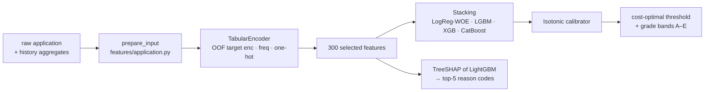

# Architecture

```mermaid
flowchart LR
    subgraph Browser
        UI[React dashboard<br/>Vite · TanStack Query · Recharts]
    end
    subgraph Public
        NGINX[nginx<br/>static SPA + /api proxy]
        DJ[Django + DRF<br/>JWT · roles · audit]
    end
    subgraph Internal
        SV[FastAPI serving<br/>risklens Scorer]
        W[Celery worker<br/>batch scoring · drift]
        B[Celery beat<br/>nightly jobs]
    end
    subgraph Data
        PG[(Postgres 16<br/>+ pgvector)]
        RD[(Redis<br/>broker · fraud history)]
        S3[(MinIO / S3<br/>DVC · MLflow artifacts · reports)]
        MF[MLflow<br/>tracking + registry]
    end
    subgraph Observability
        PR[Prometheus] --> GF[Grafana]
    end
    subgraph CI[GitHub Actions]
        TR[ml-train.yml<br/>dvc pull → validate → train → eval → challenger]
        AP{{manual approval<br/>production env}}
    end

    UI --> NGINX --> DJ
    DJ -- httpx · retry · timeout --> SV
    DJ --> PG
    DJ --> RD
    B --> RD --> W
    W --> SV
    W --> S3
    SV -- models:/…@champion --> MF
    MF --> S3
    SV -- velocity history --> RD
    PR -- /metrics --> SV
    TR --> MF
    TR --> AP -- alias champion --> MF
    AP -- POST /v1/model/reload --> SV
    W -. drift > 0.2 → workflow_dispatch .-> TR
```

## Layers & dependency rule

```
frontend → backend API → services → (serving HTTP | ml package)
```

* **`ml/` (package `risklens`) never imports Django.** It is used by the CLI, notebooks, the
  serving app, and (optionally) the Celery worker for Evidently reports.
* **Views and tasks are thin.** DRF views validate → call `services.py` → serialize.
  Celery tasks load ids → call services. All business rules (override needs a comment,
  final decisions are admin-only, re-scoring a decided application is forbidden) live in
  `apps/scoring/services.py` and are unit-tested.
* **Serving is internal.** Browsers never call it; Django does, through `ServingClient`
  (2 s connect / 5 s read timeout, exponential retries on 5xx/connection errors only,
  request-id propagation, errors mapped to 503 / 422).

## The Scorer bundle — one object from training to serving



`risklens.scorer.Scorer` contains every step above and is saved as an MLflow **pyfunc**
model. Training calls `prepare_input` on the raw dataset; serving calls the *same function*
on the request — there is no second implementation of any feature, so training/serving skew
is impossible by construction (see `ml/tests/test_features_fraud.py::test_online_equals_offline`).

## Fraud: online features

Velocity features (transactions of the same card / reconstructed client id in the last
1 h / 24 h / 7 d, amount vs. the client's running mean, seconds since last transaction) only
look **backwards**. Serving keeps the last 500 events per card in Redis
(`HistoryStore` protocol; in-memory implementation for tests), builds
`[history + new transaction]`, runs the same `fraud_features` function and scores the last
row. p95 ≈ 10–20 ms in-process, enforced by `serving/tests/test_api.py::test_fraud_latency_budget` (< 50 ms).

## Model lifecycle

| Step | Where | What |
|---|---|---|
| Data versioning | DVC → MinIO `s3://risklens-dvc` | raw CSVs, features parquet, frozen split file |
| Validation | pandera (`data/schemas.py`) | pipeline fails on schema violation |
| Training | `risklens train` | every model = nested MLflow run; git SHA + DVC hash + config logged |
| Registration | MLflow registry | new version of `risklens-credit` / `risklens-fraud` |
| Promotion | `pipelines/promote.py` | AUC ≥ champion + 0.002 **and** expected cost not worse **and** gender gap ≤ 0.10 → alias `challenger` |
| Approval | GitHub environment `production` | human approves → alias `champion` |
| Deployment | serving | polls the alias every 5 min or `POST /v1/model/reload` |
| Shadow mode | serving (`SHADOW_ENABLED=true`) | challenger scores every request; both logged; `risklens_shadow_abs_diff` in Grafana |
| Monitoring | Celery beat 02:00 | PSI per feature + prediction PSI → `DriftReport`; Evidently HTML in MinIO; optional auto-retrain |
